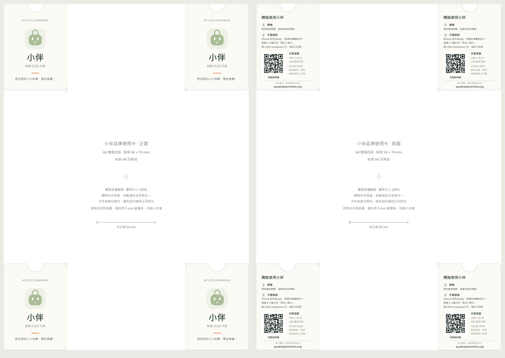

# 小伴操作卡：A4 雙面四角 4 張

成品每張 **54 × 74 mm**；頂端中央是**內凹半圓**，直徑 14 mm、深 7 mm，四角 R2.5 mm。正面為品牌與產品名稱，背面為開機、配對、說明書 QR、充電注意事項與官網。

- [貼齊四角 PDF](operation-card-a4-4-corners.pdf)：四邊留白 0 mm，適合可印到紙邊的設備。
- [四角留 5 mm PDF](operation-card-a4-4-corners-5mm.pdf)：無法印到紙邊時使用，卡片尺寸仍相同。
- [給影印店的完整設定](print-instructions.txt)。兩份 PDF 選一份，均為第 1 頁正面、第 2 頁背面。
- 編輯用單卡向量：[正面](front.svg)、[背面](back.svg)、[裁切外框](cutline.svg)。字型依原 SVG 與編輯軟體可用字型處理；正式印製優先使用已排好的 PDF。

**A4 直式、雙面長邊翻面、實際大小 100%。** 關閉符合頁面、自動縮放及多頁合一；先試印一張，量中央校正線 50 mm，再核對正反對位。沒有出血；內凹半圓與圓角需異形或手工裁切。尚未完成實際影印店試印，機器走紙偏移需現場調整。

卡上 QR 是 `https://quadcopteronline.org/manual/`，不含裝置授權碼；專屬配對卡應另附。兩份 PDF 背面重新以 180 dpi 轉圖，各解出 4 個相同公開網址。

